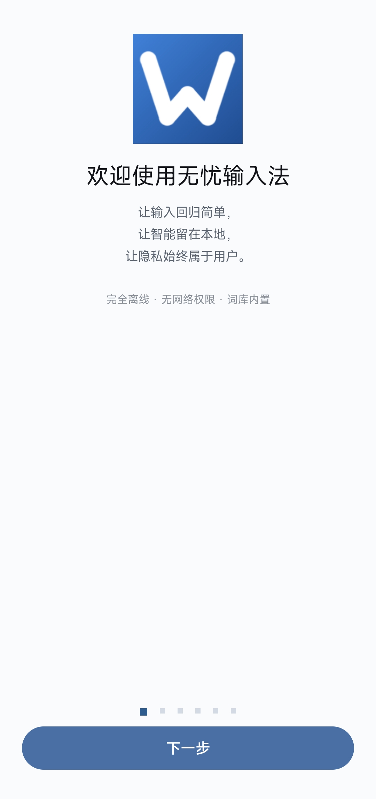
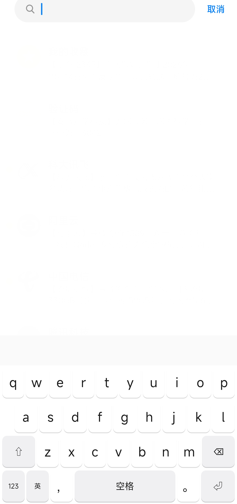
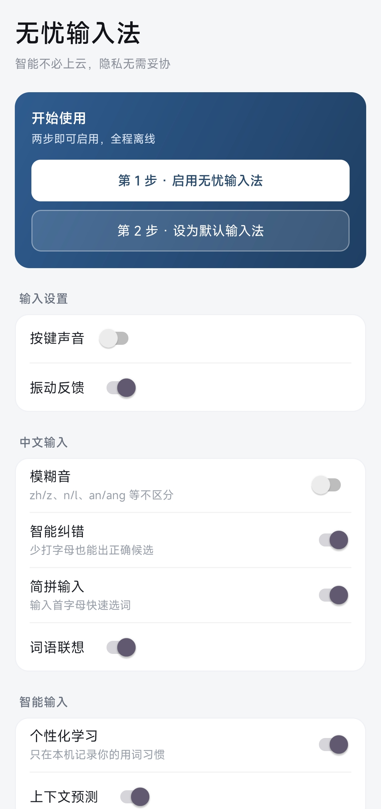

# 开源发布步骤

仓库已经在本地准备好了（2 次提交、工作区干净）。下面是从"本地仓库"到"GitHub 上公开"的完整步骤。

**建议在电脑上操作**，手机终端做这些会很别扭。

---

## 一、先决定仓库地址

在 GitHub 网页上：

1. 右上角 `+` → **New repository**
2. 填写：
   - **Repository name**：`wuyou-ime`（或你喜欢的名字）
   - **Description**：`无忧输入法 —— 智能不必上云，隐私无需妥协。完全离线的安卓拼音输入法`
   - **Public**（要开源就选公开）
   - **不要**勾选 "Add a README file"、".gitignore"、"license"
     （仓库里已经有了，勾了会造成推送冲突）
3. 点 **Create repository**

创建后你会看到仓库地址，形如：

```
https://github.com/你的用户名/wuyou-ime.git
```

---

## 二、把代码推上去

### 方式 A：在有项目文件的电脑上（推荐）

如果项目目录已经在你电脑上（把 `/sdcard/ai代码/无忧输入法` 整个拷过去即可）：

```bash
cd 无忧输入法

# 关联远程仓库（换成你自己的地址）
git remote add origin https://github.com/你的用户名/wuyou-ime.git

# 推送（分支名是 master）
git push -u origin master
```

如果 GitHub 要求凭据，密码处要填 **Personal Access Token**，不是账号密码。
生成方法：GitHub → Settings → Developer settings → Personal access tokens →
Tokens (classic) → Generate new token → 勾选 `repo` 权限。

### 方式 B：用打包好的 bundle（项目文件不方便拷时）

仓库已经导出成单文件 `发布/wuyou-ime.bundle`（3.5 MB，含完整提交历史）。

把 `wuyou-ime.bundle` 拷到电脑上，然后：

```bash
# 从 bundle 克隆出一个完整仓库
git clone wuyou-ime.bundle wuyou-ime
cd wuyou-ime

# 关联远程仓库
git remote add origin https://github.com/你的用户名/wuyou-ime.git

# 推送
git push -u origin master
```

`git clone` 出来的仓库，提交历史、作者信息、文件都完整，和方式 A 最终效果一样。

---

## 三、发布一个 APK（Release）

代码推上去之后，建议在 GitHub 上发一个 Release，让别人能直接下载安装：

1. 仓库页右侧 → **Releases** → **Create a new release**
2. **Choose a tag**：填 `v2.0.0` → 点 "Create new tag"
3. **Release title**：`无忧输入法 V2.0.0`
4. **描述**里写清楚：
   - 完全离线，不申请网络权限
   - 词库 33.7 万词
   - 支持整句输入
   - APK 需要 Android 8.0+
   - **这是 debug 签名版本，仅供测试**
5. 上传 APK：把 `app-debug.apk` 改名为 `wuyou-ime-v2.0.0.apk` 再上传
6. 点 **Publish release**

> APK 不入库（`.gitignore` 已排除 `*.apk`），走 Release 附件才是正确做法。

---

## 四、正式签名（发布正式版前必做）

现在仓库里的 APK 是 debug 签名，不适合正式分发。配置正式签名：

```bash
# 在项目根目录执行
./tools/gen-keystore.sh
```

按提示输入两次密码，脚本会生成：

- `wuyou-release.jks` —— 密钥库
- `keystore.properties` —— 构建时读取的配置

这两个文件都已在 `.gitignore` 里，**不会**被提交。

生成后构建 release 包：

```bash
./gradlew assembleRelease
```

产物在 `app/build/outputs/apk/release/app-release.apk`。

**务必离线备份 `wuyou-release.jks` 和密码。**
一旦丢失，已经发布的应用就再也无法用同一个签名更新了（用户必须卸载重装）。

别人 clone 你的仓库时没有密钥库，构建会自动退回 debug 签名，不会报错。

---

## 五、补截图到 README

README 目前是纯文字，建议补 3–4 张真机截图：

1. 引导页第 1 页（欢迎页）
2. 键盘打字界面（展示候选栏和整句输入）
3. 设置页
4. 主题选择

截图后放进 `docs/screenshots/` 目录，然后在 README 的功能介绍下方加：

```markdown
## 截图

| 引导页 | 键盘 | 设置 |
|--------|------|------|
|  |  |  |
```

---

## 六、推之前最后检查一遍

```bash
# 1. 确认没有密钥、APK、本地配置被误提交
git ls-files | grep -E "\.jks$|\.keystore$|keystore\.properties$|\.apk$"
# 应该没有任何输出

# 2. 确认 gradle.properties 不含本地路径
grep -E "/root/|/sdcard/|aapt2FromMavenOverride" gradle.properties
# 应该没有任何输出

# 3. 确认工作区干净
git status
# 应该是 "nothing to commit, working tree clean"
```

三项都通过，就可以放心推送了。
