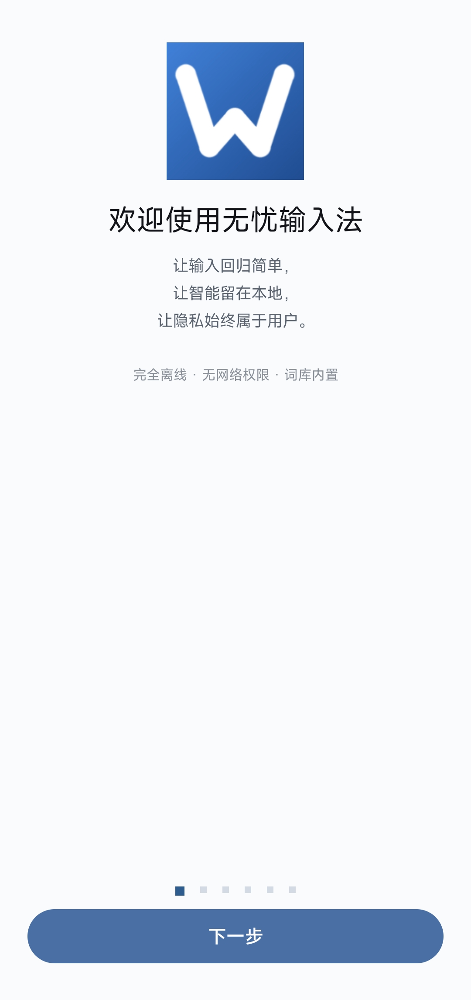
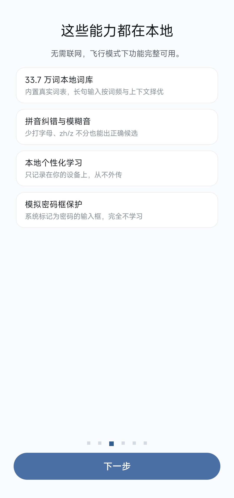
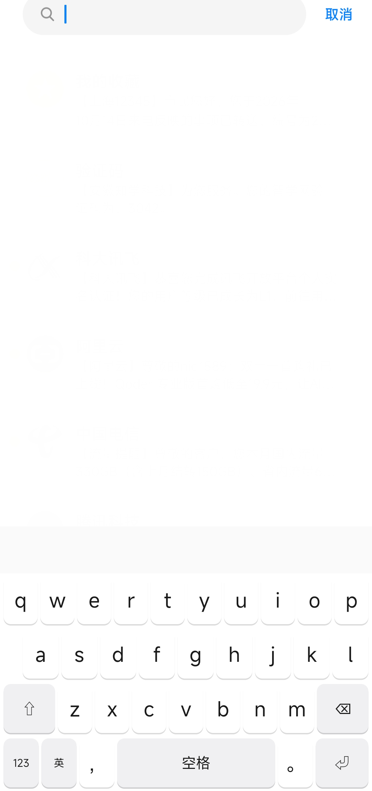
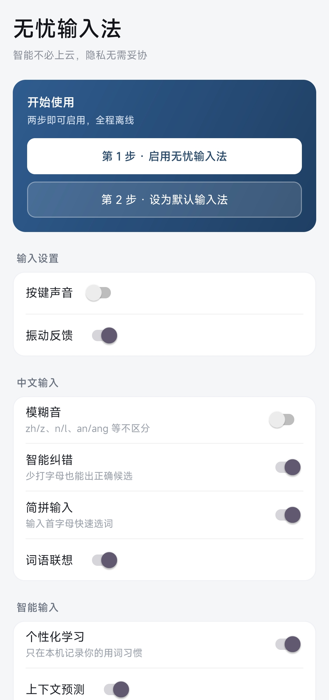

# 无忧输入法 V2.0

> 智能不必上云，隐私无需妥协。

一款**完全离线、零网络权限**的原生 Android 拼音输入法。词库随应用内置，学习只发生在
本机内存与私有数据库里。飞行模式下，全部功能照常可用。

[简体中文](README.md) | [English](README_EN.md)

---

## 它有什么不同

绝大多数输入法做不到「不联网」——因为预测、纠错、词库更新都依赖云端。无忧输入法把这些
能力全部下放到本地：

| 能力 | 常见输入法 | 无忧输入法 |
|------|-----------|-----------|
| 词库 | 云端下发 | **APK 内置 33.7 万词** |
| 长句预测 | 服务器推理 | 本地动态规划 + 词频打分 |
| 智能纠错 | 云端模型 | 本地截断补全 + 模糊音映射 |
| 个性化学习 | 上传云端画像 | **只写本机私有 SQLite** |
| 隐私承诺 | 政策文本 | **系统层面无联网能力（无 INTERNET 权限）** |

安装后可自行验证：`设置 → 应用 → 无忧输入法 → 权限`，**没有网络权限**。打开飞行模式，
一句话都不会打不出来。

## 功能

- **拼音输入**：全拼 / 简拼 / 首字母；模糊音（zh-z、n-l、an-ang…）；智能纠错（少打字母也能出）
- **整句输入**：整串拼音直接转成一句话，按空格一次上屏（`jintiantianqi` → 今天天气）。
  没有语言模型时按字拼会出错（"金天天气"），这里用 DP 在**词**一级做最优分词
- **长句输入**：动态规划穷举音节切分，保证长串输入完整覆盖、不被截断
- **选词续接**：选一个词后**剩余拼音保留**，继续出下一段候选（选「今天」→ 剩 `tianqi` → 出「天气」）
- **多音字消歧**：词组层面标注读音（长江 → `chang jiang`，不会读成 `zhang`）
- **键盘布局**：QWERTY 拼音 / 英文、九宫格 T9、符号、数字、Emoji
- **英文输入**：预测、纠错、自动大写、自动空格
- **本地学习**：记录选词频率与前后搭配；密码框与隐私模式下**完全不学习**
- **剪贴板管理**：本地历史，**默认关闭**，仅键盘前台时读取
- **智能短语**：内置常用短语 + 自定义缩写展开
- **外观主题**：6 套主题（纯白极简 / 深空黑 / 极简灰 / 清新蓝 / 米白柔和 / 深色护眼）。
  液态玻璃主题因绘制问题暂时下架，代码保留在 `KeyboardView.drawLiquidGlass`
- **首次引导**：6 页引导流程，隐私政策、用户协议、免责声明**分别独立确认**，不捆绑同意

## 截图

| 欢迎页 | 能力介绍 |
|--------|----------|
|  |  |

| 键盘 | 设置 |
|------|------|
|  |  |

## 隐私设计

这不是一句宣传语，是几个可以被检验的技术决定：

1. **不声明 `INTERNET` 权限**
   `AndroidManifest.xml` 里没有这一行。Android 的权限模型决定了应用无法发起任何网络请求，
   与代码怎么写无关。

2. **零第三方联网 SDK**
   没有统计、广告、推送、崩溃上报、远程日志。使用统计无处可去，因为无处可发。

3. **输入内容只在内存中流转**
   密码框、可见密码框、标记 `IME_FLAG_NO_PERSONALIZED_LEARNING` 的输入框：
   不学习、不记录、不参与联想。

4. **学习数据不出应用沙箱**
   用户词与上下文共存在应用私有的 SQLite 中，其他应用无权读取。

5. **禁止云备份与设备迁移**
   `allowBackup=false` + `data_extraction_rules.xml` 显式排除
   `root`、`database`、`sharedpref`、`file` 全部四个域。
   你的词库不会被同步到任何账号。

6. **剪贴板默认不读**
   历史功能默认关闭，开启后也只在键盘可见、用户主动触达时读取。

## 构建

环境要求：JDK 17、Android SDK（Platform 34 + Build-Tools 34.0.0）

```bash
git clone https://github.com/<your-org>/wuyou-ime.git
cd wuyou-ime
./gradlew :app:assembleDebug
```

产物：`app/build/outputs/apk/debug/app-debug.apk`

安装并启用：

```bash
adb install -r app/build/outputs/apk/debug/app-debug.apk
# 设置 → 语言和输入法 → 管理键盘 → 勾选「无忧输入法」
# 设置 → 语言和输入法 → 当前输入法 → 选择「无忧输入法」
```

也可以打开 App 首页，按「第 1 步 / 第 2 步」引导完成。

## 词库

`app/src/main/assets/dict/` 下两个制表符分隔的文本文件：

| 文件 | 规模 | 格式 |
|------|------|------|
| `chars.txt` | 6,663 行 | `汉字<TAB>拼音<TAB>频率排名` |
| `words.txt` | 336,900 行 | `词组<TAB>拼音（空格分隔）<TAB>词频` |

首启时由 `DictionaryImporter` 分批事务导入 SQLite（每 2 万条提交一次）。
导入版本号见 `ASSET_VERSION`，递增即可触发重建。

词库基于 jieba 官方词表（MIT）生成，拼音由 pypinyin 标注。详见
[THIRD_PARTY_NOTICES.md](THIRD_PARTY_NOTICES.md)。

## 目录结构

```
app/src/main/java/com/wuyou/ime/
├── WuyouApplication.kt          应用入口：设置缓存、后台词库导入
├── keyboard/
│   ├── WuyouInputMethodService.kt   InputMethodService 实现（核心）
│   ├── KeyboardView.kt              自绘键盘：QWERTY/T9/符号/数字
│   ├── CandidateBarView.kt          候选栏
│   └── FeedbackHelper.kt            振动与按键音
├── engine/
│   ├── PinyinSyllables.kt           合法音节表
│   └── PinyinParser.kt              动态规划切分、模糊音、纠错、T9
├── prediction/CandidateEngine.kt    候选排序（词频 + 上下文 + 用户词）
├── personalization/
│   ├── UserModel.kt                 本地学习
│   └── SmartPhrase.kt               智能短语
├── dictionary/DictionaryImporter.kt 内置词库导入
├── storage/DictionaryDatabase.kt    SQLite 表结构
├── settings/                        SettingsManager / 设置中心 / 词库管理
├── themes/ThemeManager.kt           主题定义
├── emoji/EmojiData.kt               Emoji 分类数据
├── clipboard/ClipboardManager.kt    剪贴板历史
└── privacy/PrivacyActivity.kt       隐私说明
```

## 技术栈

- Kotlin，`InputMethodService`（系统级输入法，非应用内虚拟键盘）
- minSdk 26（Android 8.0）/ targetSdk & compileSdk 34
- SQLite（`SQLiteOpenHelper`，无 ORM）、DataStore Preferences
- Material 3 主题
- 键帽、候选栏均为 Canvas 自绘，无第三方 UI 组件

## 许可

源代码以 **Mozilla Public License 2.0** 授权，见 [LICENSE](LICENSE)。

选 MPL-2.0 而不是 MIT/Apache，是因为它带**文件级著佐权**：你可以把本项目用于
闭源产品、可以修改，但修改过的那些源文件必须同样以 MPL 开源。既方便商用集成，
又避免整个项目被一方悄悄私有化——对输入法这种直接处理用户全部文字的产品，
这个约束是合适的。

词库数据的第三方许可见 [THIRD_PARTY_NOTICES.md](THIRD_PARTY_NOTICES.md)，
其中 jieba 词表为 MIT，需保留其版权声明。

## 贡献

欢迎 Issue 与 PR。提交前请确认：

- 不引入任何联网依赖、统计 SDK 或分析埋点
- 不新增 `INTERNET` 等网络权限
- 涉及数据处理的改动，同步更新 `PrivacyActivity` 中的隐私说明
- 保持离线可用：断网、飞行模式下功能不应退化

## 免责声明

本项目为独立实现，不隶属于任何输入法厂商，未包含任何第三方产品的代码、图标、
字体或私有词库。
